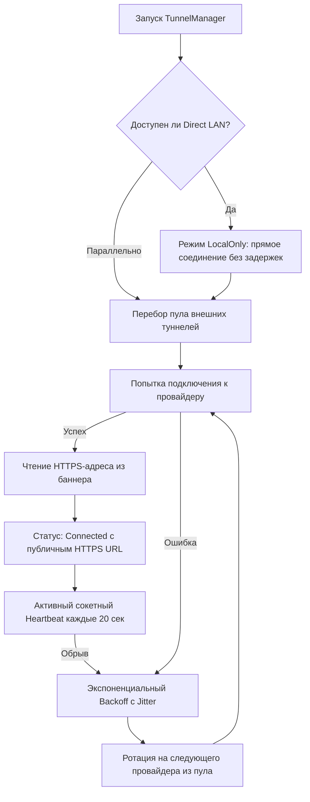

# 🌐 Сетевой стек и отказоустойчивые туннели (core-network)

## Концепция $0 Serverless инфраструктуры
Все приложения экосистемы (`UniTest`, `Tdroid`, `TDRobotics`, `SuperDriver`, `TDnetScript`) способны взаимодействовать по сети **без аренды выделенных серверов (VPS)** и без покупки доменных имен.

Сетевой модуль решает задачу доступа к локальному HTTP/WebSocket серверу, запущенному на телефоне или компьютере, из внешней глобальной сети или локального Wi-Fi.

---

## Архитектура работы `TunnelManager`



---

## 1. Пул бесплатных шлюзов (Fallback Gateways)
Если один из провайдеров временно перегружен, закрыт или блокируется провайдером, менеджер автоматически переключается на следующий:

1. **`localhost.run`** (SSH Reverse Tunneling через порт 22, протокол nokey).
2. **`pinggy.io`** (`a.pinggy.io:22`, моментальная генерация HTTPS ссылок).
3. **`serveo.net`** (`serveo.net:22`, классический порт-форвардинг).
4. **`telebit.cloud`** (SSH туннелирование).
5. **`bore.pub`** (Легковесный TCP/HTTP прокси).
6. **`Cloudflare Quick Tunnel`** (`trycloudflare.com`, резервный шлюз).

---

## 2. Приоритет прямого соединения (Direct LAN)
Если учитель и ученики или компьютер и мобильное устройство находятся в одной локальной сети (подключены к одному роутеру или телефон раздает точку доступа Wi-Fi Hotspot):
- `NetworkUtils.getLocalIpAddress()` мгновенно определяет реальный IP (`192.168.x.x`).
- Приложение сразу переходит в режим `TunnelState.LocalOnly("http://192.168.x.x:port")`.
- Это обеспечивает **нулевой пинг**, независимость от интернет-провайдера и работу даже при полном отсутствии доступа в Интернет.

---

## 3. Защита от сбоев и зависаний
- **Exponential Backoff с Jitter**: задержка повтора начинается с 2 секунд, удваивается (4с -> 8с -> до макс. 30с) с добавлением случайного джиттера `0..1000мс`, чтобы предотвратить лавинообразную нагрузку на шлюзы.
- **20-секундный активный Heartbeat**: отправляет `session.sendKeepAliveMsg()`. Если TCP-сессия зависла (например, при переходе с Wi-Fi на 4G), сокет немедленно принудительно разрывается, инициируя бесшовное переподключение.
- **Энергосбережение Android**: при интеграции в сервис используйте `PARTIAL_WAKE_LOCK` и `WIFI_MODE_FULL_HIGH_PERF`, чтобы Android не усыплял Wi-Fi процессор.

---

## Пример использования в коде

```kotlin
val tunnelManager = TunnelManager(localPort = 8080)

// Подписка на изменение состояния туннеля
scope.launch {
    tunnelManager.tunnelState.collect { state ->
        when (state) {
            is TunnelState.Connected -> {
                println("Внешний URL: ${state.publicUrl} (через ${state.provider})")
            }
            is TunnelState.LocalOnly -> {
                println("Локальный URL в сети Wi-Fi: ${state.localUrl}")
            }
            is TunnelState.Connecting -> println("Подключение к туннелю...")
            is TunnelState.Error -> println("Ошибка: ${state.message}")
            is TunnelState.Idle -> println("Туннель остановлен")
        }
    }
}

// Запуск
tunnelManager.start(scope)

// Остановка
tunnelManager.stop()
```
